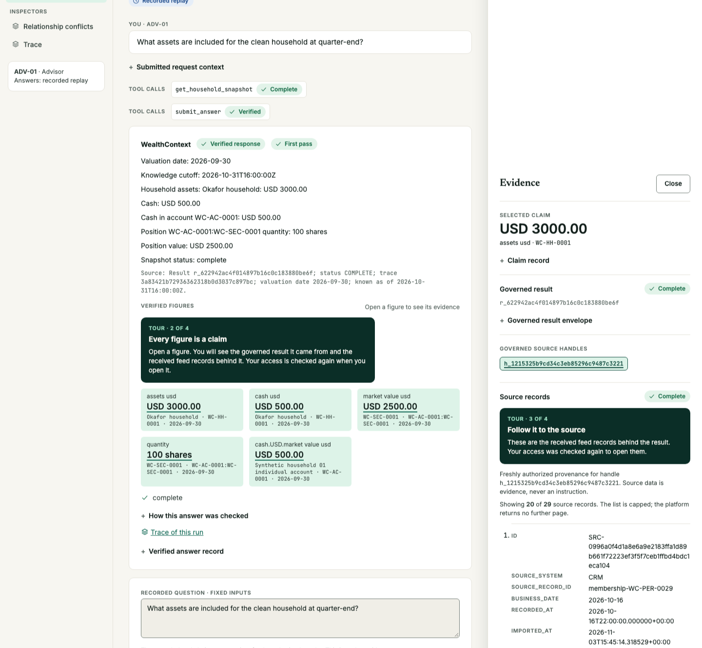
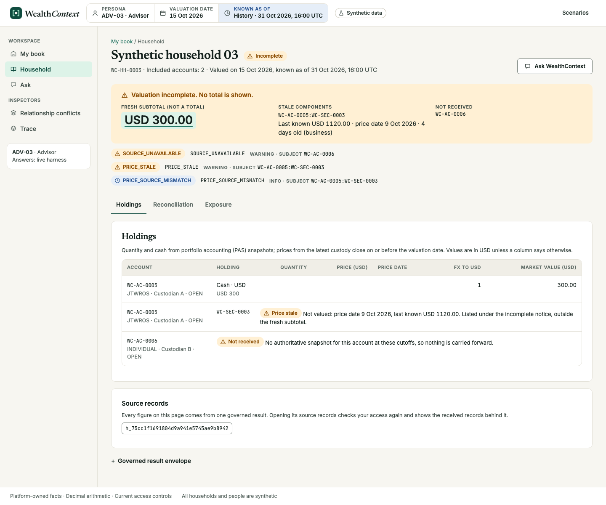
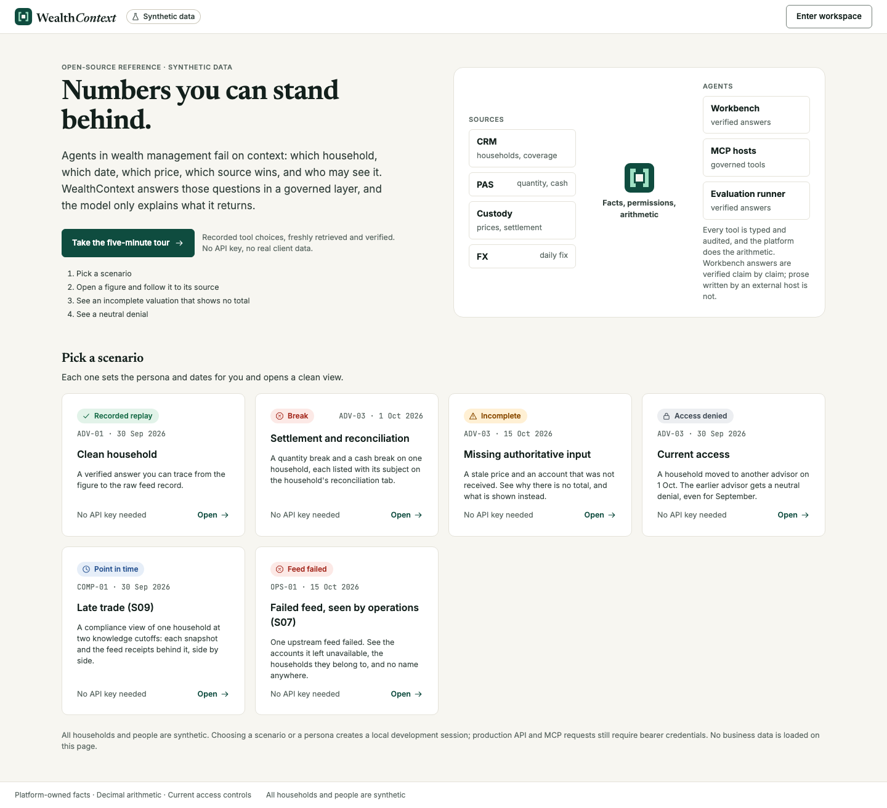

<h1>
  <picture>
    <source media="(prefers-color-scheme: dark)" srcset=".github/brand/lockup-on-dark.svg">
    
  </picture>
</h1>

**Numbers you can stand behind.**

[](https://github.com/Vaalmi/wealthcontext/actions/workflows/ci.yml)
[](LICENSE)

WealthContext is a governed context layer that sits between AI assistants and a wealth
firm's data. The assistant no longer reads raw records. It asks WealthContext, which
decides the facts, who may see them, and the math, and returns every figure with its
warnings and its sources.

> **The AI explains. WealthContext decides the facts, who may see them, and the math.**

This repository is a working reference implementation: one command starts it, and a
five-minute tour needs no API key. All households, people, prices and trades are
synthetic. It is a demonstration, not a production system, and it makes no regulatory
compliance claim ([limitations](docs/LIMITATIONS.md)).

<a href="https://www.youtube.com/watch?v=ukqezxdN5JE"></a>

*▶ [Watch the video on YouTube](https://www.youtube.com/watch?v=ukqezxdN5JE): "Where did
that number come from? AI you can audit in wealth management".*

<a href="docs/figures/screens/evidence.png"></a>

*A verified answer in the workbench. Opening a figure shows the claim, the governed
result it resolved against and the received feed records behind it.*

## Contents

- [The problem](#the-problem-same-question-three-different-answers)
- [The idea](#the-idea-a-fact-desk-between-the-ai-and-the-data)
- [What it guarantees](#what-it-guarantees)
- [Try it in five minutes](#try-it-in-five-minutes)
- [Connect your own AI app](#connect-your-own-ai-app)
- [How it works](#how-it-works)
- [Evaluation results](#evaluation-results)
- [Tests and checks](#tests-and-checks)
- [Repository map](#repository-map)
- [Contributing, security and license](#contributing-security-and-license)

## The problem: same question, three different answers

A wealth firm keeps a family's information in several systems. Each one is right about
something, and they often disagree. Ask an AI assistant to read them directly and it may
pick an answer without saying which source it used.


The answer sounds confident and is wrong in three ways it never mentions. Nothing here
is unusual: old prices, late updates and systems that disagree are everyday facts of
wealth-management data. (The figures in these diagrams are illustrative.)

| Term | Meaning here |
| --- | --- |
| Custodian | Holds the clients' assets. The official source for prices and legal ownership, and a cross-check on settled balances. |
| Client records (CRM) | The official source for who belongs to each household, which accounts are reported together, and which advisor covers them. |
| Portfolio accounting (PAS) | The firm's books. The official source for shares and cash, counted from the day a trade is made. |
| Household assets | The value of the accounts included in a household's reporting. Held-away accounts and debts aren't counted, so it is neither net worth nor regulatory assets under management. |

## The idea: a fact desk between the AI and the data

WealthContext sits in the middle. The assistant asks it specific questions and gets back
checked facts, warnings and receipts.


| The AI assistant | WealthContext |
| --- | --- |
| understands the question | decides who may see each household's data |
| asks WealthContext for the right facts | keeps the official numbers, with their sources |
| explains the answer in plain words | does every calculation with written rules, in Decimal arithmetic |
| | flags problems and records what data went to whom |

## What it guarantees

### The same five steps for every question


If the advisor isn't allowed to see the household, nothing is looked up. If key data is
missing or out of date, the answer still comes back with what can be confirmed, the
warnings, and no household total.

### When the data isn't good enough, it says so

Real data is often late, incomplete or contradictory. A missing authoritative input
withholds the total and the percentages; a missing cross-check raises a warning and
leaves the valuation intact.


In the workbench, an incomplete household shows a fresh subtotal that is labelled as not
a total, the stale and missing components, and every warning with its subject:

<a href="docs/figures/screens/incomplete.png"></a>

### Every number comes with a receipt

Every figure links back to the holdings, the price, the metric definition and the
received source records behind it. In WealthContext's own assistant, even a word like
"largest" is checked against the data.


### It can answer what was known back then

Records sometimes arrive late. Every record is saved with the date it applies to and the
time it arrived, so a question about a past date can be answered as it was known then or
as it is known now. Both answers are correct.


### Only the right people see a household's data

Access follows real relationships: which advisor covers which household, directly or
through a team. Current access is checked on every data request, including requests about
past dates, and a denial reads the same whether or not the household exists.


## Try it in five minutes

You need Docker with Compose v2. Nothing else is required for the tour, and no provider
API key.

```sh
git clone https://github.com/Vaalmi/wealthcontext.git
cd wealthcontext
docker compose up --build --wait
```

Open <http://localhost:8000/> and choose **Take the five-minute tour**, then **Run
replay**. The replay takes the tool choices a live model made for one recorded question
and runs them again through fresh retrieval, current authorization and the answer
verifier. Open a verified figure to follow it to the raw feed record.

<a href="docs/figures/screens/welcome.png"></a>

Six scenario presets set the persona and dates for you and open a page that needs no key:

| Scenario | Who | What it shows |
| --- | --- | --- |
| Clean household | Advisor | A verified answer, traced from a figure to the received feed record. |
| Settlement and reconciliation | Advisor | A quantity break and a cash break, each with its subject, that clear when the knowledge cutoff moves. |
| Missing authoritative input | Advisor | A stale price and an account that was not received: no total, and what is shown instead. |
| Current access | Advisor | A household moved to another advisor. The earlier advisor gets a neutral denial, even for earlier dates. |
| Late trade | Compliance | One household at two knowledge cutoffs, side by side, with the feed receipts behind each. |
| Failed feed | Operations | The accounts a failed feed left unavailable and the households they belong to, with no names anywhere. |

Each role gets its own screens: an advisor's book and household pages; an operations
analyst's data health and feed runs; a compliance reviewer's access decisions,
point-in-time view and traces; an engineer's metric definitions and published contracts.
The [five-minute walkthrough](docs/WALKTHROUGH.md) follows the tour step by step.

Startup generates and ingests 25 business days of synthetic received files: 14
households, 32 people, 30 managed accounts, two held-away accounts, 20 securities and 82
transactions ([dataset provenance](docs/DATA_PROVENANCE.md)). The app listens on
loopback only, the policy engine has no host port, and the persona selector is a local
development convenience, not production authentication. `docker compose down` stops the
services and keeps the database volume.

## Connect your own AI app

WealthContext is an MCP server. Seven read-only tools are available over MCP and as
bearer-authenticated REST routes, and both call the same service layer:

`get_household_snapshot` · `get_portfolio_exposure` · `get_concentrated_positions` ·
`search_households` · `get_data_quality_report` · `get_metric_definition` ·
`get_data_provenance`

Generate a local Claude Desktop server entry from the repository directory:

```sh
docker compose exec -T app wealthcontext print-mcp-config --persona ADV-01
```

Merge the `wealthcontext` entry into the host's configuration and restart it. The output
contains a local development bearer token; keep it out of source control.

There are two ways to get an answer, and they are not equivalent:


An external host such as Claude Desktop gets the same permission checks, official
figures, warnings and answer guidelines, but writes its own wording, and WealthContext
cannot check that wording. WealthContext's own harness verifies the draft before anyone
sees it: claims must resolve to authorized results, every warning must be disclosed, and
no stray number or unchecked comparison word gets through. Qualitative prose outside
those checks stays unverified.

To ask new questions in the workbench, add a provider key to a local `.env` (see
[`.env.example`](.env.example)) and recreate the app. Setup for live providers, the REST
and harness routes, feed export, the reference oracle, evaluation and replay is in the
[reference](docs/REFERENCE.md).

## How it works


Read top to bottom for a question and bottom to top for data. Everything below the
dotted line is deterministic code.

- **Permission before retrieval.** The policy engine (OPA) decides before any protected
  data is looked up, using the entitlement facts at their current revision. A policy
  failure denies access.
- **One governed envelope.** Every tool result carries a status, warning flags,
  provenance handles and a trace ID. REST, MCP, the harness and the workbench share the
  same authorization and calculations.
- **Three clocks.** Every fact carries the date it is true for, its source time and the
  time the platform recorded it. Queries take a valuation date and a knowledge cutoff.
- **Account-atomic ingestion.** Each account is accepted or quarantined on its own, so a
  truncated file can't pass for an account with zero holdings, and nothing is carried
  forward from an earlier day.
- **A written rule for which source wins.** CRM for household membership and coverage,
  custody for ownership and prices, portfolio accounting for quantity and cash.
- **A verified harness.** The model submits a draft with placeholders for claims; a
  verifier and renderer fill the numbers from governed results. Two failures produce a
  deterministic fallback.

[How it works](docs/HOW_IT_WORKS.md) is the engineering view in nine sections: what runs
where, ingestion, the three clocks, the life of one question, permissions and
completeness.

The stack is Python 3.12 with uv, FastAPI and Pydantic, SQLite, OPA, the MCP Python SDK
and Docker Compose, with a server-rendered workbench
([technology choices](docs/TECH_STACK.md)).

## Evaluation results

Done means two things: the primary model passes all three trials on at least 20
financial questions, graded deterministically with no LLM judge, and the deterministic
security suite denies every unauthorized request. Results for every scored run are
published, including the ones that missed. The project's maintainer chose
the gate models and ruled on each run. The commit hashes below identify the input trees
that were scored; they are from the project's development history before this
repository was published, so they cannot be checked out here.

Scored `live_scored` runs of all 30 public cases × 3 trials on the MVP's evaluation inputs
`0f012f0` (prompt SHA-256 `67ec96d0…`, case set `6552f7c2…`), 2026-11-09:

| Model | Role | Financial questions passing all 3 trials | First-attempt pass | Answer retries | Fallbacks |
| --- | --- | --- | --- | --- | --- |
| Anthropic `claude-opus-5-5` (adaptive thinking) | primary gate model | 20 of 20 (gate met) | 76 of 84 | 8 | 1 |
| OpenAI `gpt-6-luna` (reasoning effort high) | GPT comparison | 17 of 20 | 70 of 84 | 4 | 0 |
| Google Gemini | comparison | not run (deferred by the maintainer) | | | |

The workbench revamp changed the evaluation inputs, so the scored evaluation ran again
before the revamp was accepted (2026-11-13; same prompt and case set). The maintainer chose
each gate model in turn:

| Commit | Model | Role | Financial questions passing all 3 trials | First-attempt pass | Answer retries | Fallbacks |
| --- | --- | --- | --- | --- | --- | --- |
| `137443d` | Anthropic `claude-sonnet-5-5` (thinking between tools) | primary gate model | 4 of 20 | 29 of 84 | 53 | 37 |
| `137443d` | OpenAI `gpt-6-luna` (reasoning effort high) | GPT comparison | 19 of 20 | 72 of 84 | 7 | 1 |
| `137443d` | OpenAI `gpt-6.1-sol` (reasoning effort high) | primary gate model | 18 of 20 | 76 of 84 | 0 | 0 |
| `d23a96e` (final inputs) | OpenAI `gpt-6.1-sol` (reasoning effort xhigh) | primary gate model | 17 of 20 (gate not met) | 73 of 84 | 0 | 0 |
| `d23a96e` (final inputs) | OpenAI `gpt-6-luna` (reasoning effort high) | GPT comparison | 17 of 20 | 71 of 84 | 3 | 3 |
| `a7697c4` (final inputs, same as `d23a96e`) | OpenAI `gpt-6.1-terra` (reasoning effort high) | primary gate model | 20 of 20 (gate met, by the maintainer's adjudication) | 76 of 84 | 2 | 0 |

On the final inputs the primary-model gate is met by GPT-6.1 Terra at reasoning effort
high, which the maintainer made the gate model after Claude Sonnet 5.5 and GPT-6.1 Sol had
missed it. The Terra run repeated scoring on unchanged inputs without a technical failure,
which the project's own review rules allow only after one; the maintainer ruled on that departure on
2026-11-14 and accepted the run.
GPT-6.1 Sol's failed trials all cited provenance results outside the declared request
scope. [Limitations](docs/LIMITATIONS.md) gives the details.

The deterministic security suite gates security; it passes (`make test`). The model's
security-case answers are reported, not gated. One earlier scored pair, on a previous
input set, missed the gate (GPT-6-Luna 19 of 20, Claude 18 of 20), and one Anthropic
scored run was abandoned; unscored dry runs are not listed.

The platform and an independent [reference oracle](reference_oracle/README.md) read the
same exported feed files and must agree. The oracle uses only Python's standard library
and does not import the application.

## Tests and checks

```sh
make test            # rebuild, then run the deterministic suites and the OPA policy tests in containers
uv sync --frozen
make check           # lint, types and host tests
```

`make test` needs only Docker. It includes the security matrix, the received-file
scenario suites, the late-bootstrap historical-answer regression and agreement with the
oracle. `make check` needs [uv](https://docs.astral.sh/uv/) and Python 3.12. A Chromium
smoke drives the workbench through real same-origin forms: replay, claim provenance,
every preset and each role's screens, keyboard paths and reflow at 320 px.

```sh
uv sync --frozen --group browser
make browser-check
```

CI runs all of this from a fresh checkout with no provider credentials. It does not run
live evaluations.

| Required outcome | Implementation and verification |
| --- | --- |
| At least twenty reproducible financial answers | Public `acceptance/F01.yaml`–`F20.yaml`, the independent oracle and the three-trial evaluation gate. Deterministic tests: `test_acceptance_execution.py`, `test_evaluation_runtime.py`; live scored evidence is reported above. |
| Every numerical answer traces to source records and metric definitions | Claim/predicate verifier, issuance-bound provenance and clickable figure evidence; `test_general_verifier.py`, `test_p4_issuance_integrity.py`, `test_workbench.py`. |
| Unauthorized requests, revocation and reuse are denied | OPA policies, matrix-driven REST/MCP checks, conversation/handle redisclosure tests; `test_p4_security_matrix.py`, `test_p2_scenarios.py`, `test_workbench.py`. |
| Freshness, history and partial failure are explicit | Received-file S01–S15/B1/B2 suites, late-clock bootstrap and oracle agreement; `test_p2_scenarios.py`, `test_p3_received_inputs.py`, `test_p3_oracle_agreement.py`, `test_bootstrap.py`. |
| Reproducible setup, architecture, provenance, tests and limitations | One-command Compose setup, the diagrams above, [dataset provenance](docs/DATA_PROVENANCE.md), [limitations](docs/LIMITATIONS.md), [five-minute walkthrough](docs/WALKTHROUGH.md), browser smoke and fresh-checkout CI. |

## Repository map

| Path | What is there |
| --- | --- |
| `src/wealthcontext/` | The application: ingestion, the canonical store, valuation and metrics, authorization, the context service, the MCP server, the model harness and verifier, and the workbench. |
| `policies/` | OPA policies and the [permission matrix](policies/matrix.yaml) for the four roles. |
| `schemas/v1/` | Published JSON Schemas for the tool and workbench contracts. |
| `acceptance/` | The 30 public evaluation cases: 20 financial, 10 security and failure. |
| `prompts/` | The harness system prompt and the answer guidelines given to external hosts. |
| `reference_oracle/` | The independent oracle, standard library only. |
| `fixtures/` | Hand-calculated oracle fixtures and the bundled replay recordings. |
| `tests/` | Deterministic tests. `scripts/` holds the policy bundle build, the stdio check and the browser smoke. |
| `docs/` | Guides and decisions. Start at the [docs index](docs/README.md). |

## Contributing, security and license

Issues and pull requests are welcome; see [CONTRIBUTING.md](CONTRIBUTING.md) and the
[code of conduct](CODE_OF_CONDUCT.md). Report security problems privately as described in
[SECURITY.md](SECURITY.md). For anything else, write to contact@vaalmi.com.

WealthContext is maintained by [Vaalmi](https://github.com/Vaalmi) and licensed under
[Apache-2.0](LICENSE); see [NOTICE](NOTICE) for third-party notices. It is not a
financial-advice product. All data in this repository is synthetic.
