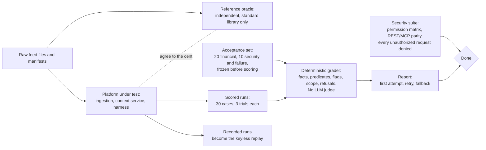

# How WealthContext works

The engineering view, for builders and reviewers. The [README](../README.md) explains the
idea in plain language; this page shows how it is put together. Sections 4 to 7 follow one
advisor question through time, permissions and valuation.

> **Models interpret and explain. The platform owns facts, permissions and the math.**

Household IDs, revision numbers and dollar amounts in the drawings are illustrative,
and all data is synthetic. Scenario IDs (S01 to S15, B1, B2) name the scenarios the
received-file test suites exercise.

Colour key: blue marks a permission or verification step, green allowed or complete,
amber a warning or incomplete, red denied or wrong. Dashed lines are returns, optional
paths or absences.

1. [The big picture](#1-the-big-picture)
2. [What runs where](#2-what-runs-where)
3. [How data gets in](#3-how-data-gets-in)
4. [Three clocks](#4-three-clocks)
5. [Life of one question](#5-life-of-one-question)
6. [Permission before retrieval](#6-permission-before-retrieval)
7. [Is the number complete?](#7-is-the-number-complete)
8. [Two ways to answer](#8-two-ways-to-answer)
9. [How it is proved](#9-how-it-is-proved)

## 1. The big picture

Three kinds of client sit on top. Everything below the line is deterministic code: a
question travels down through permissions, the context service and the metric engine to
versioned data, and data arrives from the bottom through ingestion.

Read top to bottom for a question, bottom to top for data. The blue arrow on the left is
why revocation takes effect on the next request: access facts live in the same store as
the data, and the gateway reads them at the current revision.

## 2. What runs where

One command starts two containers. An MCP host such as Claude Desktop starts a third,
the bridge, only when it opens a session. Only the app container touches the database or
asks OPA for a decision.

Port 8000 on the app is the only port published to your computer, on loopback. The
workbench's replay needs no keys and makes no provider calls; a live question calls the
provider you configured. External hosts run their own models.
`wealthcontext print-mcp-config` prints the full stdio launch command
([reference](REFERENCE.md#mcp-hosts)).

## 3. How data gets in

Five feeds arrive as files with manifests. Each account is accepted or quarantined on
its own, then all accepted rows publish together in one transaction, with a visible
record of what failed.

A truncated file can't pass for an account with zero holdings: step 3 commits nothing
for any account whose rows don't match its manifest entry. Re-running the same file
changes nothing, and missing inputs stay missing: nothing is carried forward from an
earlier day.

### Which source wins

| Fact | Authoritative | Checked against | Outcome |
| --- | --- | --- | --- |
| Household membership, reporting household, advisor coverage | CRM | Portfolio accounting groupings | CRM wins over portfolio accounting and is cited, with a `HOUSEHOLD_MEMBERSHIP_CONFLICT` or `REPORTING_HOUSEHOLD_CONFLICT` warning. A contradiction inside CRM with no winner (S02) raises `AMBIGUOUS_ENTITY` and blocks completeness. Other households stay hidden unless you can see them. |
| Registration, legal owners, account status | Custody | CRM | `OWNERSHIP_CONFLICT` warning |
| Valuation quantity and cash, tax lots | Portfolio accounting, trade date | Custody settled quantity and cash | `PENDING_SETTLEMENT`, `MATCHED`, or a `QUANTITY_BREAK` / `CASH_BREAK` warning |
| Prices | Custody end-of-day price file | Portfolio accounting price | Custody's price always wins. Too old: `PRICE_STALE`, household incomplete. A different PAS price raises `PRICE_SOURCE_MISMATCH` (info). |
| FX rates | FX fix file | None | Missing rate: `FX_UNAVAILABLE`, household incomplete |

**Availability rule.** A missing authoritative input makes the affected position
unavailable and the household `INCOMPLETE`. A missing secondary input, such as a
truncated custody positions file, raises `RECONCILIATION_UNAVAILABLE` and leaves the
valuation intact.

## 4. Three clocks

Every fact carries the date it is true for, its source time (the file's business date,
plus the source's own timestamp when it gives one), and the time WealthContext recorded
it. Queries filter on the first and the last; the chart shows both.

Scenario S09: a trade dated 29 September is recorded late, on 6 October. The same
question about 30 September returns 1,000 shares when you ask what was known on 3
October, and 1,200 with today's knowledge. Sample history uses a simulated recording
clock, so these answers are identical on any install date. Price freshness is a separate
check: a price's date is compared with the valuation date, with no lag allowed for US
listings and one business day for non-US listings.

## 5. Life of one question

An advisor asks which households hold 10% or more in a single issuer. Seventeen messages
later they see an answer in which every figure came from a tool result.

OPA decides before any protected data is looked up; the only thing read first is the
entitlement facts it needs, from the same read snapshot as the data. The model never
touches the database and never does arithmetic; the harness checks its draft before
anyone sees it.

## 6. Permission before retrieval

Access comes from relationships: an advisor covers a household directly or through a
team. Other roles get narrower grants, and operations users see IDs instead of client
names. When CRM reassigns a household, the change and a new entitlement revision commit
together.

Scenario S04. Once the reassignment commits, later requests and handle resolutions by
the earlier advisor are denied, and WealthContext's harness tombstones results and
earlier answers that are no longer accessible. Content already delivered cannot be
recalled. Invalid or unavailable OPA responses fail closed with `POLICY_UNAVAILABLE`. In
the shipped dataset the reassigned household is `WC-HH-0004`, which moves from `ADV-03`
to `ADV-05` on 1 October ([walkthrough](WALKTHROUGH.md#330-see-a-current-access-denial)).

- A denial is `NOT_AUTHORIZED` whether or not the ID exists; `NOT_FOUND` is returned
  only after access is allowed.
- Access is checked at request time. The valuation date picks the data; the
  entitlements are today's.
- The [permission matrix](../policies/matrix.yaml) sets what each role may call and what
  is projected out of the response.

## 7. Is the number complete?

A household total needs authoritative inputs for every position and cash balance, and
resolved household membership. Custody's settled positions are a cross-check, not an
input, so losing them raises a warning instead of blocking the total.

Left: a missing or stale input, or unresolved membership, marks the household
`INCOMPLETE`; the response gives the fresh subtotal, the stale items at their last-known
values and the missing items, but no total. Right: scenario S13a, a buy on quarter-end
that settles the next day.

## 8. Two ways to answer

Both paths receive the same governed data. Only WealthContext's own harness can check
the wording. In an external host, the answer guidelines ask the host model to quote
figures exactly, cite trace IDs and list warnings, but nothing enforces it.

The difference is the verifier. It checks claims, predicates, warnings, stray numbers
and a list of comparison words; qualitative prose outside those checks stays unverified.
That is why the scored evaluation runs through the harness and not through an external
host.

## 9. How it is proved

The platform and an independent oracle read the same raw files and must agree.
Hand-reviewed acceptance answers and hand-calculated oracle fixtures guard against a
mistake both share.

Done means the primary model passes all three trials on at least 20 financial questions,
and the security suite denies every unauthorized request, including after revocation and
with reused handles or results. Every scored run is published, including the ones that
missed the gate: see [evaluation results](../README.md#evaluation-results).
