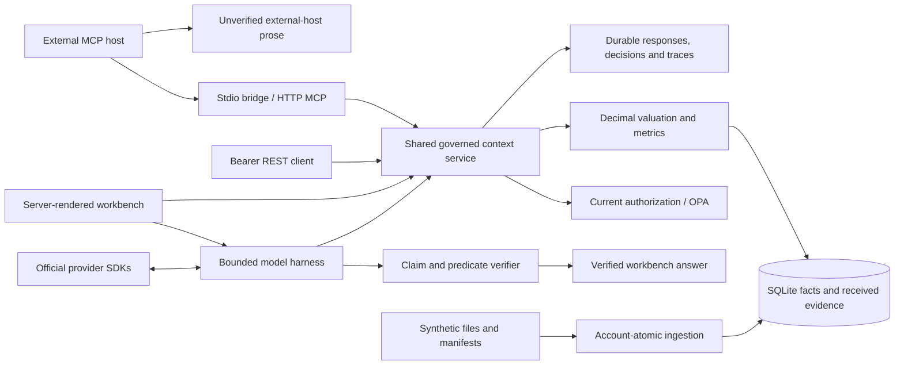

# Running and operating WealthContext

Commands and interfaces for the local demonstration. The [README](../README.md) has the
short version, and the [five-minute walkthrough](WALKTHROUGH.md) covers the workbench.
Everything here uses synthetic data.

## Start and stop

```sh
docker compose up --build --wait
make test
```

The health endpoint is `http://localhost:8000/health`. The app listens on loopback only; OPA has no host port. The database is a named volume. `docker compose down` stops the services and preserves it. App, optional bridge and test service share the same current app image; the bridge/test services have no database volume or private policy network.

`make up`, `make down`, `make check`, `make test`, `make schemas` and `make browser-check`
wrap the common commands; see the [`Makefile`](../Makefile).

## The workbench

Open `http://localhost:8000/` for the server-rendered workbench. Choose **Take the
five-minute tour**, then **Run replay** for the genuine no-key GPT-6-Luna recording. Its
fixed clean request is re-executed with fresh results and current authorization.
Verified figures open the claim, the governed result and the received feed records
behind it. Each role gets its own screens: an advisor's book and household pages, an
operations analyst's data health and feed runs, a compliance reviewer's access
decisions, point-in-time view and traces, and an engineer's metric definitions and
published contracts. Six scenario presets set the persona and dates and open a data
page that needs no key: a settlement discrepancy, an incomplete valuation, an access
denial, a late trade and a failed feed, besides the recording.

The local selector is explicitly limited to known synthetic development personas.
It uses an opaque HttpOnly session cookie and same-origin CSRF-protected forms.
Changing persona or cutoffs clears the displayed view; API and MCP bearer checks
remain separate. This selector is not production authentication. Live controls show
provider availability without exposing keys; only the clean preset has a genuine
recording, and replay does not count as a new live evaluation.

## The synthetic dataset

Startup generates and ingests 25 business days of synthetic received files: 14 households, 32 people, 30 managed accounts, two held-away accounts, 20 securities and 82 transactions with acquisition lots. Each file has a manifest; snapshot manifests establish completeness per account. A failed PAS account prevents a total, while missing custody reconciliation produces a warning. CRM household membership and reporting remain separate from custody legal ownership. Historical queries use both the business date and the time the platform received a record.

The clean control remains `WC-HH-0001` at `2026-09-30`: 100 shares at USD 25 plus USD 500 cash, yielding USD 3,000. `ADV-01` has a direct grant; other advisors do not. The first harness response is scripted and verified against a recorded result; it is not a live-model evaluation.

To inspect a reproducible copy of the received history without starting the app:

```sh
uv sync --frozen
uv run wealthcontext generate-feeds --output runtime/feeds --seed 2026
```

The export contains newline-framed feed files, manifests and an index of simulated receipt times. It includes a genuinely truncated custody file and failed-fetch evidence. It contains no expected-answer file. Import time does not replace simulated receipt time, so a late bootstrap preserves historical answers. See [dataset provenance](DATA_PROVENANCE.md).

## Valuation and the reference oracle

Valuation applies current daily FX fixes and listing-specific price freshness. Incomplete inputs produce a fresh subtotal and explicit diagnostics without an asset total. Exposure keeps operating-company issuers separate from fund vehicles; concentration includes cash/MMF in the denominator, compares unrounded ratios, and reports every indeterminate household. Book queries evaluate only currently authorized households.

The independent [reference oracle](../reference_oracle/README.md) reads the exported files with Python's standard library, without importing the application:

```sh
python3 -m reference_oracle runtime/feeds --household WC-HH-0014 \
  --as-of 2026-09-30 --known-as-of 2026-10-17T12:00:00Z --summary
```

## MCP hosts

Generate a local Claude Desktop server configuration from the repository directory:

```sh
docker compose exec -T app wealthcontext print-mcp-config --persona ADV-01
```

Merge its `wealthcontext` server entry into Claude Desktop's configuration, preserving existing servers, and restart the host to load it. The output includes a local 30-day dev bearer token; keep it out of source control. When Compose was started without the repository's `PWD`, supply `--project-dir /ABS/PATH/wealthcontext`. The generated launch command uses an absolute Compose path and no TTY. An optional `--docker-command` overrides the default macOS Docker Desktop executable path.

The implemented tools are `get_household_snapshot`, `get_portfolio_exposure`, `get_concentrated_positions`, `search_households`, `get_data_quality_report`, `get_metric_definition` and `get_data_provenance`. The server also provides `wealthcontext://metrics/catalog` and the selectable `wealthcontext_answer` prompt. Initialize instructions and that prompt share the same versioned guidelines. They guide external-host prose; WealthContext does not verify that prose.

```sh
uv run python scripts/check_stdio.py --compose /ABS/PATH/wealthcontext/compose.yaml
make check
make test
```

The stdio check launches from a temporary directory and checks current/legacy protocol modes, bearer forwarding, a tool call, a resource read, a prompt fetch, instructions and clean shutdown.

## REST, roles and inspectors

The internal scripted harness is `POST /api/harness/one-claim`; the REST tools are `POST /api/<tool_name>`. Both require a bearer token minted with `wealthcontext token --persona ADV-01` inside the app container. Contract and API documentation also require a valid token. Trace JSONL and durable audit/response evidence remain in the app's local data volume.

The [permission matrix](../policies/matrix.yaml) governs the four personas. Advisors see currently covered households, including active team coverage; ops receives quality diagnostics with names and account titles redacted; compliance can inspect lineage and decision history; engineers can inspect contracts and metric definitions. Inspector reads use `POST /api/feed_runs`, `/api/conflicts`, `/api/decision_log`, `/api/eval_reports` and `/api/trace`, with the permissions and typed arguments published in OpenAPI. Evaluation reports derive metadata and counts from persisted P5 runs and trials; they do not expose prompts, transcripts or financial figures.

The harness rebuilds conversation context before a turn or history render. Revoked tool results and answers citing them become tombstones, while the original response evidence stays in the audit store. The same current authorization applies to provenance handles and historical queries.

## The verified harness and live providers

The general harness is `POST /api/harness/answer`, with `question`, optional
`conversation_id`, optional cutoffs and `provider` (default `openai`). Its response
contains a verified rendered answer and run metadata, including retry and fallback
flags. `POST /api/harness/history` accepts `conversation_id` and reauthorizes the
current display. A conversation belongs to the authenticated persona; supplying
another persona's conversation ID does not transfer access.

Live calls default to OpenAI GPT-6-Luna (`gpt-6-luna`, reasoning effort high); OpenAI GPT-6.1 Terra (`gpt-6.1-terra`, reasoning effort high) is the primary model for the scored acceptance gate on the revamp's evaluation inputs (Claude `claude-opus-5-5` was on the MVP's), and GPT-6-Luna its published GPT comparison; see [evaluation results](../README.md#evaluation-results). The Google adapter remains in scope, with its live comparison deferred.

For live OpenAI calls (the live-call default, `gpt-6-luna` at reasoning effort high), add
`OPENAI_API_KEY` to the ignored local `.env`; for Anthropic, add `ANTHROPIC_API_KEY`
and optional `ANTHROPIC_WORKSPACE_ID`. Then recreate the app with Compose and choose
the provider per request. Optional model and effort overrides are shown in `.env.example`. Compose passes only
the declared provider settings to the app; the bridge, test and policy containers
receive no provider credentials. Keep rendered Compose configurations private because
they can contain interpolated keys. The Python CLI reads environment variables and
does not load `.env` by itself. Replay and deterministic tests require no keys.

## Evaluation and replay

Evaluation runs all thirty public cases three times in a fresh isolated directory:

```sh
uv run wealthcontext evaluate --provider openai --mode live_calibration \
  --repository /ABS/PATH/wealthcontext --data-dir /ABS/PATH/fresh-evaluation \
  --opa-url http://127.0.0.1:8181 --bundle-dir /ABS/PATH/wealthcontext/build/policy
```

That host command requires a separately reachable OPA with the matching bundle;
Compose deliberately does not publish its OPA port. Within the app container, omit
`--opa-url` and `--bundle-dir` to use the configured internal service and bundle.
Calibration is unscored. `--mode live_scored` additionally requires the actual Git
checkout and exact acceptance files plus freeze manifest committed in HEAD. An
ordinary application image lacks that Git checkout and cannot satisfy this gate.
`wealthcontext freeze-acceptance --repository /ABS/PATH/wealthcontext` writes the
manifest but does not commit it or establish scored readiness.

Replay uses a completed, verified live recording, fresh retrieval and current
permissions, with no API calls or evaluation score:

```sh
uv run wealthcontext replay --recording /ABS/PATH/live-recording.json \
  --data-dir /ABS/PATH/fresh-replay --opa-url http://127.0.0.1:8181 \
  --bundle-dir /ABS/PATH/wealthcontext/build/policy
```

The same OPA connectivity requirement applies. The CLI rejects a recording that
requires pre-existing conversation history. [Limitations](LIMITATIONS.md) describes what
the verifier does not check.

## Checks

`make test` includes the late-bootstrap historical-answer regression and deterministic
security/scenario suites. The Chromium smoke uses real same-origin forms to exercise
replay, claim provenance, every preset and each role's screens: no total on an
incomplete page, every warning with its subject, neutral denials, keyboard paths,
evidence focus return, 24 px targets and reflow at 320 px and 200% text. CI starts from a checkout with no provider credentials; it does not
run live evaluations or claim deployment readiness.

For a repeatable browser smoke after starting Compose:

```sh
uv sync --frozen --group browser
make browser-check
```

The browser dependency group is optional and is not installed in the app image.
For an isolated alternate port, run `uv run --group browser python scripts/check_workbench.py --url http://127.0.0.1:8005`.
Screenshots at desktop (1440 px) and mobile (390 or 320 px) widths and the check report are written under ignored `output/playwright/`.

## Architecture in one diagram



The app is the only process that accesses SQLite and OPA. REST, MCP, harness tools
and inspectors share service authorization and calculations. The bridge carries a
bearer credential over stdio; its container has no database volume or private policy
network. Browser cookies authorize only explicit local workbench routes.
[How it works](HOW_IT_WORKS.md) draws each part in more detail.
